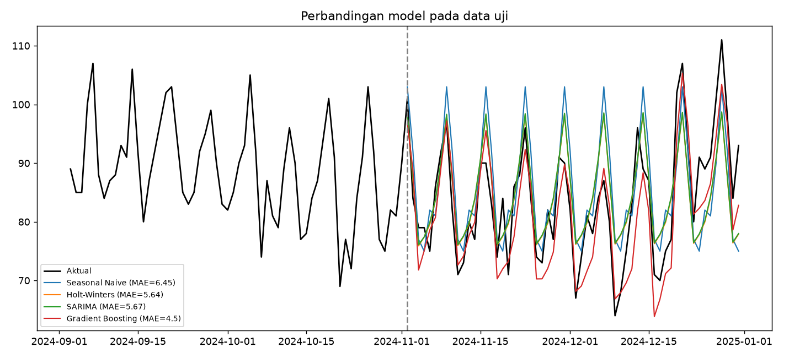
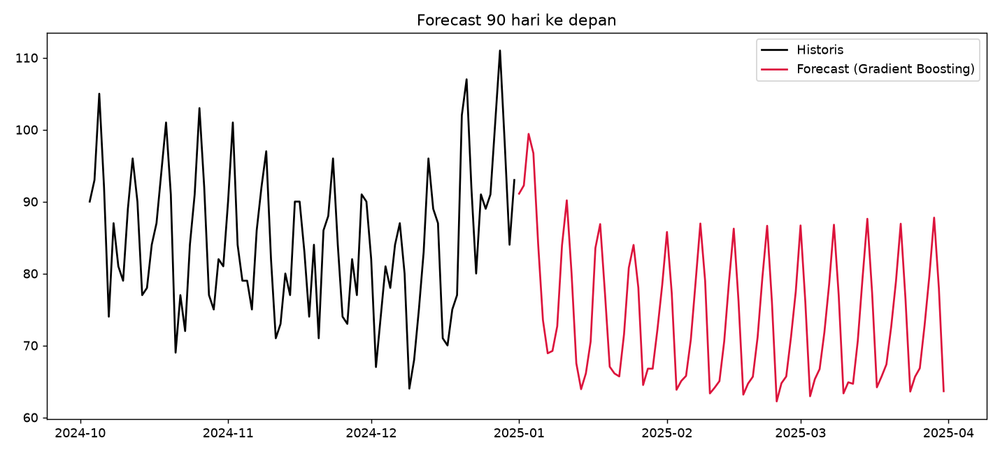

# Hotel Demand Forecasting

Proyek forecasting **jumlah kamar terjual per hari** di sebuah hotel. Membandingkan model statistik klasik dan machine learning, lalu memakai model terbaik untuk memprediksi 30 hari ke depan.

## Kenapa ini berguna?

Prediksi permintaan membantu hotel menentukan harga kamar (revenue management), jadwal staf, pembelian stok (F&B, linen), dan perencanaan promosi.

## Hasil

Evaluasi pada 60 hari terakhir (data uji, tidak dipakai saat training):

| Model | MAE (kamar) | RMSE | MAPE (%) |
|---|---|---|---|
| **Gradient Boosting** | **4.50** | 5.45 | 5.33 |
| Holt-Winters | 5.64 | 6.69 | 6.77 |
| SARIMA | 5.67 | 6.72 | 6.83 |
| Seasonal Naive (baseline) | 6.45 | 7.78 | 7.73 |

Rata-rata, tebakan model terbaik meleset sekitar 4-5 kamar per hari (dari hotel 120 kamar).




## Model yang dibandingkan

1. **Seasonal Naive**: baseline, mengulang pola 7 hari terakhir. Model lain harus mengalahkan ini.
2. **Holt-Winters** (Exponential Smoothing): menangkap trend dan musiman mingguan.
3. **SARIMA**: model statistik klasik dengan komponen musiman.
4. **Gradient Boosting**: ML biasa dengan fitur kalender (hari, bulan, akhir pekan, libur akhir tahun) dan fitur lag (nilai 1, 7, 14, 28 hari lalu). Forecast dilakukan secara rekursif.

## Poin penting metodologi

- **Split berurutan waktu**: data latih di awal, data uji di akhir. Tidak diacak, supaya tidak terjadi *data leakage*.
- **Selalu ada baseline** sebagai pembanding.
- **Model final dilatih ulang** dengan seluruh data sebelum forecast ke depan.


## Struktur proyek

```
hotel-forecasting/
├── data/hotel_daily.csv        # data (sintetis)
├── src/
│   ├── generate_data.py        # pembuat data sintetis
│   ├── explain_concepts.py     # pembuat gambar penjelas
│   └── forecast.py             # pipeline utama
├── docs/
│   ├── PANDUAN_FORECASTING.md  # panduan konsep untuk pemula
│   └── images/                 # gambar penjelas
├── outputs/                    # hasil: metrik, forecast, grafik
├── requirements.txt
└── README.md
```

## Pengembangan lanjutan

- Tambah **Prophet** atau **XGBoost/LightGBM**
- Fitur hari libur nasional Indonesia dan event lokal
- *Rolling-origin cross-validation* agar evaluasi lebih stabil
- Interval prediksi (rentang ketidakpastian)
- Forecast per tipe kamar atau per channel booking
- Dashboard dengan Streamlit

## Lisensi

MIT
