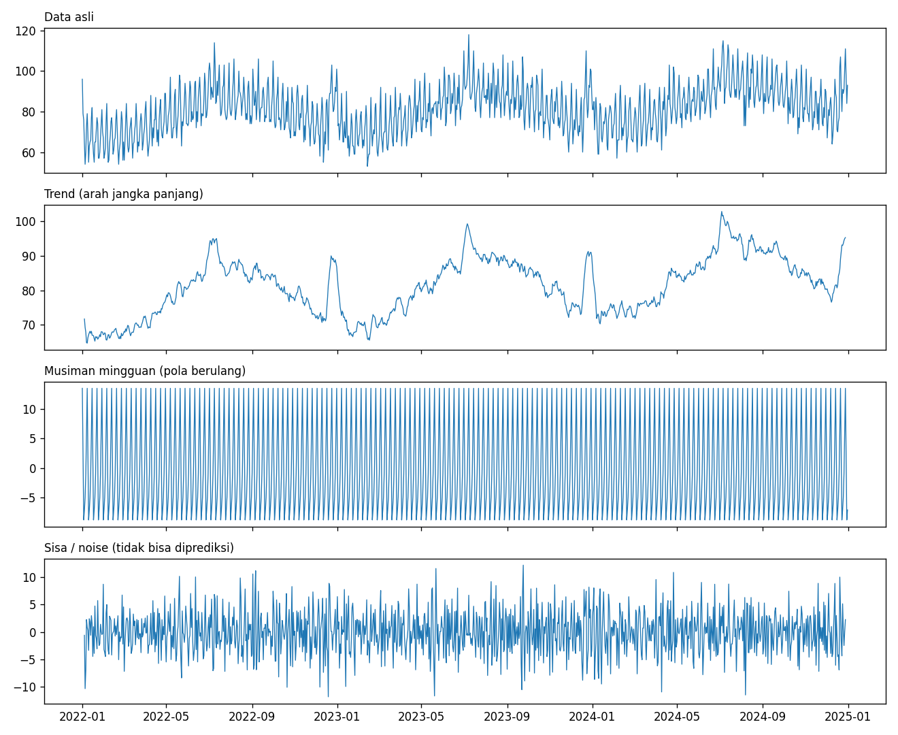
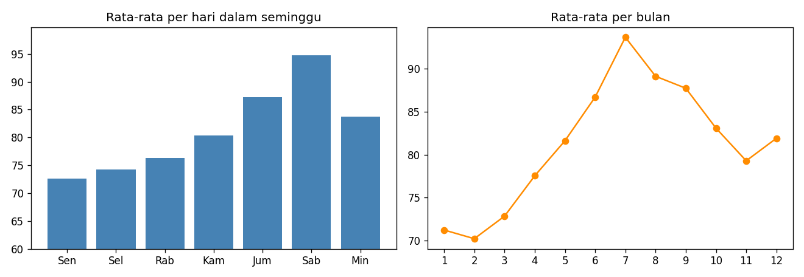
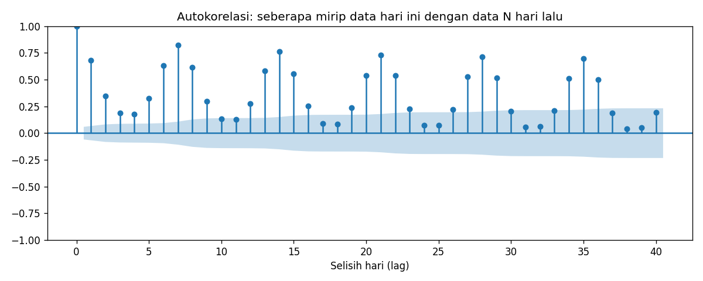
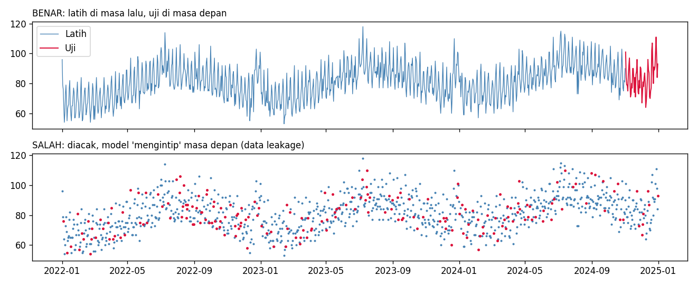

# Panduan Memahami Forecasting (untuk Pemula)

Panduan ini menjelaskan konsep forecasting lewat proyek hotel di repo ini. Tidak perlu rumus. Targetnya: setelah membaca ini dan menjalankan kodenya, kamu paham **apa yang sebenarnya dilakukan** setiap bagian proyek, dan **kenapa**.

**Cara membaca:** baca berurutan dari Bagian 1. Setiap bagian punya "Di proyek ini" yang menunjuk ke kode atau hasil nyata.

---

## Daftar Isi

1. [Apa itu forecasting?](#1-apa-itu-forecasting)
2. [Data waktu punya "komponen"](#2-data-waktu-punya-komponen)
3. [Autokorelasi: kemarin berpengaruh ke hari ini](#3-autokorelasi-kemarin-berpengaruh-ke-hari-ini)
4. [Aturan emas: jangan mengintip masa depan](#4-aturan-emas-jangan-mengintip-masa-depan)
5. [Baseline: lawan yang harus dikalahkan](#5-baseline-lawan-yang-harus-dikalahkan)
6. [Keempat model di proyek ini](#6-keempat-model-di-proyek-ini)
7. [Mengukur akurasi: MAE, RMSE, MAPE](#7-mengukur-akurasi-mae-rmse-mape)
8. [Forecast rekursif: memprediksi banyak hari ke depan](#8-forecast-rekursif-memprediksi-banyak-hari-ke-depan)
9. [Membaca hasil proyek ini](#9-membaca-hasil-proyek-ini)
10. [Kesalahan umum pemula](#10-kesalahan-umum-pemula)
11. [Peta kode](#11-peta-kode)
12. [Latihan eksperimen](#12-latihan-eksperimen)
13. [Glosarium](#13-glosarium)

---

## 1. Apa itu forecasting?

**Forecasting = memprediksi nilai di masa depan berdasarkan pola dari data masa lalu yang berurutan waktu.**

Pertanyaan yang dijawab di proyek ini: *"Berapa kamar hotel yang akan terjual setiap hari selama 30 hari ke depan?"*

### Bedanya dengan regresi biasa

Kamu sudah belajar regresi. Forecasting itu kerabat dekatnya, tapi ada satu perbedaan penting:

| | Regresi biasa | Forecasting |
|---|---|---|
| Urutan data | Tidak penting (baris boleh diacak) | **Sangat penting** (urutan waktu = informasinya) |
| Contoh | Harga rumah dari luas dan lokasi | Kamar terjual besok dari pola sebelumnya |
| Fitur utama | Variabel lain (luas, lokasi) | Nilai masa lalu dari variabel itu sendiri + kalender |
| Cara bagi data | Acak | **Berurutan waktu** |

Intinya: dalam forecasting, **waktu adalah bagian dari data**, bukan sekadar nomor baris.

---

## 2. Data waktu punya "komponen"

Hampir semua data deret waktu bisa dipecah menjadi tiga bagian:

```
Data = Trend + Musiman (Seasonality) + Sisa (Noise)
```

| Komponen | Artinya | Contoh di data hotel |
|---|---|---|
| **Trend** | Arah jangka panjang (naik/turun) | Bisnis hotel tumbuh pelan, rata-rata kamar terjual naik dari tahun ke tahun |
| **Musiman** | Pola yang **berulang** pada periode tetap | Akhir pekan ramai, Senin sepi (periode 7 hari) |
| **Sisa / noise** | Variasi acak yang tidak bisa dijelaskan | Tiba-tiba ada rombongan, atau hujan deras |



**Cara membaca gambar:** panel paling atas adalah data asli yang tampak ramai dan berantakan. Setelah dipisah, panel kedua menunjukkan arah umumnya, panel ketiga menunjukkan pola 7 harian yang rapi dan berulang, dan panel keempat adalah sisa yang tampak acak.

> **Catatan:** pada gambar di atas, panel "trend" masih naik-turun mengikuti musim tahunan (ramai di Juli, sepi di awal tahun), karena kita hanya memisahkan pola 7 harian. Itu normal. Data hotel sebenarnya punya **dua musiman sekaligus**: mingguan dan tahunan.

### Pola nyata di data kita



- **Mingguan:** Sabtu paling ramai (rata-rata sekitar 95 kamar), Senin paling sepi (sekitar 73).
- **Bulanan:** Juli puncak (sekitar 94), Februari terendah (sekitar 70).

### Kenapa ini penting?

**Tugas model forecasting pada dasarnya adalah menangkap tiga komponen ini, lalu memperpanjangnya ke masa depan.** Noise tidak bisa diprediksi, jadi akurasi sempurna mustahil. Itu normal, bukan kegagalan model.

Itulah kenapa langkah pertama di proyek ini adalah **memplot data** (`outputs/01_eksplorasi.png`): kamu harus *melihat* dulu ada trend dan musiman atau tidak, baru memilih model.

---

## 3. Autokorelasi: kemarin berpengaruh ke hari ini

Di kuliah data science kamu belajar **korelasi** antara dua variabel. **Autokorelasi** adalah korelasi sebuah variabel **dengan dirinya sendiri di masa lalu**.

Pertanyaannya: *"Seberapa mirip jumlah kamar terjual hari ini dengan jumlah N hari lalu?"*



Dari data kita:

| Selisih (lag) | Autokorelasi | Artinya |
|---|---|---|
| 1 hari | 0,68 | Hari ini cukup mirip kemarin |
| 3 hari | 0,19 | Kemiripan lemah |
| **7 hari** | **0,82** | **Sangat mirip dengan hari yang sama minggu lalu** |
| 14 hari | 0,76 | Masih mirip dengan 2 minggu lalu |

**Temuan kuncinya:** korelasi tertinggi ada di lag 7, 14, 21, dan seterusnya. Itu bukti statistik bahwa data ini punya pola mingguan. Kamis depan paling mirip dengan Kamis kemarin, bukan dengan Rabu.

**Di proyek ini:** itulah alasan model Gradient Boosting memakai fitur `lag_1`, `lag_7`, `lag_14`, `lag_28`, dan alasan model klasik memakai `seasonal_periods=7`.

---

## 4. Aturan emas: jangan mengintip masa depan

Ini kesalahan paling sering dan paling berbahaya dalam forecasting.

Di klasifikasi, kamu bebas mengacak data lalu membagi 80/20. **Di forecasting, itu dilarang.**



**Kenapa dilarang?** Bayangkan kamu mengacak data. Model dilatih dengan data 5 Mei dan 7 Mei, lalu diuji untuk menebak 6 Mei. Itu mudah sekali, karena data di kiri dan kanannya sudah diketahui. Padahal di dunia nyata, saat kamu memprediksi besok, kamu **tidak punya data lusa**.

Ini disebut **data leakage** (kebocoran data): model "mencontek" informasi dari masa depan. Akibatnya nilai evaluasi terlihat bagus, tapi saat dipakai sungguhan, hasilnya jelek.

**Aturan:** data latih selalu **sebelum** data uji secara waktu.

**Di proyek ini:**
```python
train, test = s[:-60], s[-60:]   # 60 hari terakhir = data uji
```

---

## 5. Baseline: lawan yang harus dikalahkan

Sebelum membuat model canggih, buat dulu tebakan **paling sederhana**. Ini disebut **baseline**.

Baseline kita: **Seasonal Naive**, yaitu "besok sama dengan hari yang sama minggu lalu". Hari Senin depan = Senin kemarin.

**Kenapa wajib?** Karena tanpa baseline, angka error tidak punya makna. Jika modelmu error 4,5 kamar, itu bagus atau jelek? Kamu hanya tahu setelah membandingkan: baseline error 6,45, jadi modelmu **memperbaiki 30%**.

> **Aturan praktis:** jika model rumitmu tidak mengalahkan baseline sederhana, **pakai baseline saja**. Model rumit yang tidak lebih baik hanya menambah beban perawatan.

---

## 6. Keempat model di proyek ini

Dari yang paling sederhana ke yang paling fleksibel.

### 6.1 Seasonal Naive (baseline)

- **Ide:** ulangi pola 7 hari terakhir.
- **Kelebihan:** tidak perlu training, tidak mungkin salah konfigurasi.
- **Kekurangan:** tidak menangkap trend, dan ikut menyalin noise minggu lalu.
- **Cocok untuk:** pembanding.

### 6.2 Holt-Winters (Exponential Smoothing)

- **Ide:** model mengingat tiga hal: *level* (kira-kira berapa angka saat ini), *trend* (naik/turun seberapa cepat), dan *pola musiman*. Data **yang lebih baru diberi bobot lebih besar** daripada data lama. Disebut "exponential" karena bobot data lama menurun cepat.
- **Parameter di kode:**
  - `trend="add"`: trend dijumlahkan (naik sekian kamar per hari)
  - `seasonal="add"`: efek musiman dijumlahkan (Sabtu +12 kamar dari rata-rata)
  - `seasonal_periods=7`: pola berulang tiap 7 hari
- **Kelebihan:** cepat, mudah, sangat baik untuk data dengan trend + satu musiman.
- **Kekurangan:** hanya bisa **satu** periode musiman (mingguan **atau** tahunan, bukan dua-duanya).

### 6.3 SARIMA

Nama panjangnya *Seasonal AutoRegressive Integrated Moving Average*. Pecah saja:

| Huruf | Artinya | Intuisi |
|---|---|---|
| **AR** (AutoRegressive) | Prediksi memakai nilai masa lalu | "Besok mirip kemarin dan lusa" (itu autokorelasi dari Bagian 3) |
| **I** (Integrated) | Data di-*differencing* | Alih-alih memodelkan nilai, modelkan **perubahannya** supaya trend hilang |
| **MA** (Moving Average) | Prediksi memakai **error** masa lalu | "Kemarin saya salah tebak sekian, koreksi hari ini" |
| **S** (Seasonal) | Semua di atas, tapi untuk pola musiman | Sama, tapi lompat 7 hari |

Di kode: `order=(1,1,1)` artinya AR=1, differencing=1, MA=1. `seasonal_order=(1,1,1,7)` artinya hal yang sama untuk musiman dengan periode 7.

- **Kelebihan:** kuat secara statistik, bisa memberi interval ketidakpastian.
- **Kekurangan:** pemilihan parameter butuh keahlian, lambat untuk data besar, sulit memasukkan faktor luar (libur, event).

### 6.4 Gradient Boosting (ML dengan fitur buatan)

Ini pendekatan yang berbeda secara mendasar: **ubah masalah forecasting menjadi masalah regresi biasa** yang sudah kamu kenal.

Caranya, buat tabel fitur untuk setiap hari:

| Tanggal | dow | month | is_weekend | is_year_end | lag_1 | lag_7 | lag_14 | lag_28 | roll_7 | **target** |
|---|---|---|---|---|---|---|---|---|---|---|
| 2024-03-15 | 4 | 3 | 0 | 0 | 80 | 85 | 78 | 74 | 81,2 | **87** |

Setelah itu pakai model regresi biasa (Gradient Boosting) untuk belajar "dari fitur-fitur ini, berapa targetnya?".

- **Fitur kalender** (`dow`, `month`, `is_weekend`, `is_year_end`): memberi tahu model hari apa dan bulan apa.
- **Fitur lag** (`lag_1`, `lag_7`, ...): nilai di masa lalu.
- **`roll_7`**: rata-rata 7 hari terakhir (gambaran tren terkini).
- **Kelebihan:** fleksibel, **bisa menambah fitur apa saja** (hari libur, event, harga, cuaca), mengenali musiman mingguan **dan** tahunan sekaligus lewat fitur `month` dan `doy_sin/cos`.
- **Kekurangan:** kamu harus membuat fiturnya sendiri, dan forecast jauh ke depan harus rekursif (Bagian 8).

### Kenapa Gradient Boosting menang di proyek ini?

Karena data hotel punya **dua musiman sekaligus** (mingguan + tahunan) **plus lonjakan libur akhir tahun**. Holt-Winters dan SARIMA di sini hanya diberi periode 7, sehingga tidak tahu soal pola tahunan dan libur akhir tahun. Gradient Boosting tahu, karena fiturnya memuat bulan dan penanda akhir tahun.

> **Pelajaran penting:** model yang menang bukan "yang paling canggih", tapi **yang informasinya paling cocok dengan pola data**. Jika kita menambah fitur ke model lain, hasil bisa berbeda.

---

## 7. Mengukur akurasi: MAE, RMSE, MAPE

Setelah model memprediksi 60 hari uji, bandingkan dengan nilai aktual. Selisihnya disebut **error**.

Contoh 3 hari:

| Hari | Aktual | Prediksi | Error | |Error| | Error² |
|---|---|---|---|---|---|
| 1 | 90 | 86 | 4 | 4 | 16 |
| 2 | 80 | 83 | -3 | 3 | 9 |
| 3 | 100 | 92 | 8 | 8 | 64 |

### MAE (Mean Absolute Error)

Rata-rata dari |error| = (4 + 3 + 8) / 3 = **5 kamar**.
Mudah dibaca: *"Rata-rata tebakan kita meleset 5 kamar."* **Inilah metrik utama proyek ini.**

### RMSE (Root Mean Squared Error)

Akar dari rata-rata error kuadrat = √((16 + 9 + 64) / 3) ≈ **5,45 kamar**.
Mirip MAE, tapi **menghukum error besar lebih berat** (karena dikuadratkan). Jika RMSE jauh lebih besar dari MAE, artinya ada beberapa tebakan yang meleset sangat jauh.

### MAPE (Mean Absolute Percentage Error)

Error dalam persen: rata-rata dari (|error| / aktual). Untuk contoh di atas, sekitar **5,4%**.
Berguna untuk komunikasi ke non-teknis: *"Prediksi kita rata-rata meleset sekitar 5%."* Hati-hati: tidak cocok jika nilai aktual bisa mendekati nol.

### Mana yang dipakai?

- **MAE:** pilihan pertama, paling mudah dijelaskan.
- **RMSE:** jika error besar sangat merugikan (misal kekurangan stok).
- **MAPE:** untuk laporan ke atasan atau klien.

---

## 8. Forecast rekursif: memprediksi banyak hari ke depan

Masalah di model Gradient Boosting: untuk memprediksi **hari ke-5**, kita butuh `lag_1` = nilai hari ke-4. Tapi hari ke-4 **belum terjadi**. Solusinya:

```
Hari 1: pakai data nyata   -> prediksi 91,1
Hari 2: pakai prediksi hari 1 sebagai lag_1 -> prediksi 92,2
Hari 3: pakai prediksi hari 2 sebagai lag_1 -> prediksi 99,4
... dan seterusnya
```

Prediksi kemarin dipakai sebagai "data" untuk prediksi hari ini. Inilah **forecast rekursif** (lihat fungsi `gradient_boosting` di `src/forecast.py`).

**Risiko:** error **menumpuk**. Jika prediksi hari 1 meleset sedikit, hari 2 yang memakainya ikut meleset, begitu seterusnya. Karena itu:

> **Semakin jauh horizon, semakin tidak akurat.** Prediksi 7 hari ke depan jauh lebih bisa dipercaya daripada 90 hari ke depan.

---

## 9. Membaca hasil proyek ini

Setelah menjalankan `python src/forecast.py`, kamu mendapat:

| File | Isi | Cara membacanya |
|---|---|---|
| `outputs/01_eksplorasi.png` | Plot data + pola mingguan | Apakah ada trend dan musiman? |
| `outputs/metrics.csv` | Tabel error 4 model | Baris teratas = model terbaik |
| `outputs/02_perbandingan_model.png` | Prediksi vs aktual di data uji | Apakah garis model mengikuti garis hitam? |
| `outputs/03_forecast.png` | Forecast 30 hari ke depan | Hasil akhir untuk dipakai |
| `outputs/forecast.csv` | Angka forecast per tanggal | Data untuk dibagikan |

### Hasil evaluasi

| Model | MAE | Peningkatan vs baseline |
|---|---|---|
| Seasonal Naive | 6,45 | (patokan) |
| SARIMA | 5,67 | 12% lebih baik |
| Holt-Winters | 5,64 | 13% lebih baik |
| **Gradient Boosting** | **4,50** | **30% lebih baik** |

### Cara menilai grafik perbandingan

Buka `02_perbandingan_model.png`. Perhatikan:

1. **Apakah puncak dan lembah ikut?** Model bagus menangkap naik-turun tiap minggu.
2. **Apakah ada pergeseran sistematis?** Jika prediksi selalu di atas/bawah aktual, ada bias.
3. **Apakah gagal di periode tertentu?** Di data kita, selisih terbesar muncul menjelang akhir Desember, saat pola libur membuat angka naik-turun lebih tajam.

### Batas wajar akurasi

Noise di data kita punya standar deviasi sekitar 3,9 kamar. Itu **kira-kira batas bawah error** yang sulit dikalahkan model apa pun. MAE 4,5 sudah sangat dekat dengan batas itu, sehingga **memburu MAE 2 adalah sia-sia**: kamu hanya akan menghafal noise (overfitting).

---

## 10. Kesalahan umum pemula

| Kesalahan | Akibat | Cara menghindari |
|---|---|---|
| Mengacak data saat split | Data leakage, evaluasi menipu | Split berurutan waktu |
| Tidak membuat baseline | Tidak tahu model bagus atau tidak | Selalu mulai dari baseline |
| Mengabaikan musiman | Prediksi datar dan meleset | Plot data dan cek autokorelasi |
| Memakai fitur dari masa depan | Leakage tersembunyi | Pastikan setiap fitur tersedia **saat prediksi dibuat** |
| Forecast terlalu jauh | Error menumpuk | Batasi horizon sesuai kebutuhan |
| Memakai satu split saja | Hasil bisa kebetulan | Coba beberapa periode uji (rolling validation) |
| Percaya angka terlalu pasti | Salah ambil keputusan | Forecast adalah **estimasi**, bukan kepastian |
| Lupa kejadian khusus | Lonjakan tidak terprediksi | Tambahkan fitur libur dan event |

---

## 11. Peta kode

Bagian mana di `src/forecast.py` mengerjakan apa:

| Fungsi | Tugas | Bagian panduan |
|---|---|---|
| `load_data` | Baca CSV, pastikan satu baris per hari | - |
| `plot_overview` | Plot eksplorasi | Bagian 2 |
| `metrics` | Hitung MAE, RMSE, MAPE | Bagian 7 |
| `seasonal_naive` | Baseline | Bagian 5, 6.1 |
| `holt_winters` | Model exponential smoothing | Bagian 6.2 |
| `sarima` | Model SARIMA | Bagian 6.3 |
| `_calendar_features` | Fitur hari, bulan, akhir pekan | Bagian 6.4 |
| `_lag_features` | Fitur nilai masa lalu | Bagian 3, 6.4 |
| `gradient_boosting` | Model ML + forecast rekursif | Bagian 6.4, 8 |
| `main` | Split, bandingkan model, forecast final | Bagian 4, 9 |

`src/explain_concepts.py` membuat gambar penjelas di panduan ini.

---

## 12. Latihan eksperimen

Cara terbaik memahami forecasting adalah **mengubah sesuatu dan melihat akibatnya**. Coba satu per satu:

1. **Ubah panjang data uji.** Jalankan `python src/forecast.py --test-days 30`, lalu `--test-days 120`. Apakah peringkat model berubah? Kenapa?
2. **Hapus fitur lag.** Di `gradient_boosting`, hapus `lag_28`. Apakah error naik?
3. **Hapus fitur `is_year_end`.** Lihat grafik perbandingan: apakah model gagal menebak lonjakan akhir Desember?
4. **Beri Holt-Winters data yang lebih sedikit.** Latih dengan 100 hari saja. Apa yang terjadi?
5. **Naikkan horizon.** Jalankan `--horizon 90`. Perhatikan apakah forecast mulai terlihat "datar" atau aneh di akhir.
6. **Ganti data.** Pakai data hotel asli atau dataset publik, lalu amati model mana yang menang. Hasilnya belum tentu sama.
7. **Tambah baseline lain.** Misalnya "rata-rata 4 minggu terakhir untuk hari yang sama". Apakah lebih kuat dari Seasonal Naive?

Untuk setiap eksperimen, catat: **apa yang diubah, apa yang kamu perkirakan, apa hasilnya.** Jika hasil berbeda dari perkiraan, di situlah kamu belajar.

---

## 13. Glosarium

| Istilah | Arti singkat |
|---|---|
| **Time series / deret waktu** | Data yang dicatat berurutan dalam waktu |
| **Forecasting** | Memprediksi nilai masa depan dari deret waktu |
| **Horizon** | Seberapa jauh ke depan kita memprediksi (30 hari = horizon 30) |
| **Trend** | Arah naik/turun jangka panjang |
| **Seasonality / musiman** | Pola berulang pada periode tetap |
| **Noise** | Variasi acak yang tidak bisa diprediksi |
| **Autokorelasi** | Korelasi data dengan dirinya sendiri di masa lalu |
| **Lag** | Nilai pada N periode sebelumnya (`lag_7` = 7 hari lalu) |
| **Stationarity** | Rata-rata dan variasi data stabil sepanjang waktu (syarat model ARIMA klasik) |
| **Differencing** | Memodelkan perubahan antar periode, bukan nilainya, untuk menghilangkan trend |
| **Baseline** | Model paling sederhana sebagai pembanding |
| **Data leakage** | Model memakai informasi yang tidak akan tersedia saat prediksi nyata |
| **Train / test** | Data untuk belajar / data untuk menguji |
| **MAE / RMSE / MAPE** | Ukuran rata-rata error (absolut / kuadrat / persen) |
| **Overfitting** | Model menghafal noise sehingga bagus di data latih tapi buruk di data baru |
| **Forecast rekursif** | Prediksi hari ini dipakai sebagai input untuk prediksi hari berikutnya |

---

## Penutup

Rangkuman satu paragraf: **forecasting adalah menangkap trend, musiman, dan pola ketergantungan antar waktu dari data masa lalu, lalu memperpanjangnya ke depan, sambil menguji secara jujur (split berurutan waktu, ada baseline) dan menerima bahwa noise tidak bisa diprediksi.**

Jika kamu sudah bisa menjelaskan dengan kata-katamu sendiri: *apa itu trend dan musiman, kenapa split tidak boleh diacak, kenapa perlu baseline, dan apa arti MAE 4,5*, berarti kamu sudah paham fondasi forecasting.
